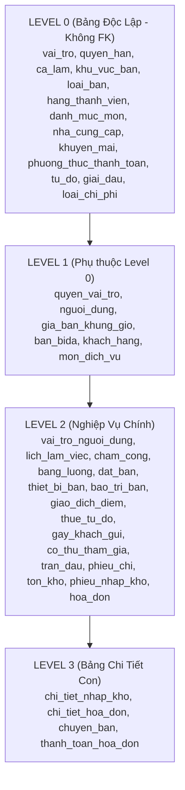

# 🎱 TÀI LIỆU ĐẶC TẢ CƠ SỞ DỮ LIỆU CHUẨN: HỆ THỐNG QUẢN LÝ QUÁN BIDA (41 BẢNG)
> **Môn học:** NET108 - Dự án .NET 1 (FPT Polytechnic)  
> **Database Engine:** Microsoft SQL Server 2019 / 2022  
> **Tên Database:** `QuanLyQuanBida`  
> **Tổng số bảng:** 41 bảng chuẩn hóa (3NF) | **Số khóa ngoại (FK):** 47 mối quan hệ toàn vẹn  
> **Mục đích:** File tài liệu cấu trúc dữ liệu dùng làm System Prompt / Context chuẩn cho AI (ChatGPT, Claude, Gemini, Cursor) và lập trình viên để sinh Entity, DAL, DTO, Controller và câu lệnh SQL chính xác 100% không bị sai lệch.

---
## 🤖 HƯỚNG DẪN DÀNH CHO AI (SYSTEM PROMPT CONTEXT)
Khi bạn (AI) nhận được yêu cầu viết code liên quan đến dự án Quản lý quán Bida này:
1. **Quy tắc đặt tên CSDL:** Luôn sử dụng đúng 100% tên bảng và tên cột bằng tiếng Việt kiểu `snake_case` (ví dụ: `ban_bida`, `mon_dich_vu`, `hoa_don`, `ma_hoa_don`, `gio_bat_dau`).
2. **Quy tắc đặt tên C# (.NET):**
   - Tên Class Entity / Model: Viết kiểu `PascalCase` (ví dụ: `BanBida`, `MonDichVu`, `HoaDon`, `ChiTietHoaDon`).
   - Tên Class DAL: Thêm hậu tố `DAL` (ví dụ: `BanBidaDAL`, `MonDichVuDAL`, `HoaDonDAL`).
   - Tên Property C#: Viết kiểu `PascalCase` (ví dụ: `Id`, `MaHoaDon`, `GioBatDau`, `TablePrice`, `TongThanhToan`).
3. **Khóa ngoại & Thứ tự thực thi:** Tuyệt đối tuân thủ phân tầng bảng từ Level 0 đến Level 3 để không vi phạm ràng buộc Foreign Key.
4. **Định dạng dữ liệu:** Mọi trường tiền tệ dùng `decimal` trong C# và `DECIMAL(18,2)` trong SQL. Trường giờ giấc trong ngày dùng `TimeSpan` trong C# và `TIME` trong SQL (từ `00:00:00` đến `23:59:59`).

---
## 📑 MỤC LỤC 6 PHÂN HỆ VÀ 41 BẢNG
### 1. Phân hệ Quản trị, Nhân sự & Phân quyền
- [`vai_tro`](#vai_tro): Vai trò người dùng
- [`quyen_han`](#quyen_han): Quyền hạn chi tiết
- [`quyen_vai_tro`](#quyen_vai_tro): Phân quyền cho vai trò
- [`nguoi_dung`](#nguoi_dung): Tài khoản người dùng (Nhân sự)
- [`vai_tro_nguoi_dung`](#vai_tro_nguoi_dung): Gán vai trò cho người dùng
- [`ca_lam`](#ca_lam): Ca làm việc
- [`lich_lam_viec`](#lich_lam_viec): Lịch phân ca nhân viên
- [`cham_cong`](#cham_cong): Bảng chấm công
- [`bang_luong`](#bang_luong): Bảng tính lương tháng
- [`nhat_ky_hoat_dong`](#nhat_ky_hoat_dong): Nhật ký hoạt động hệ thống (Audit Log)

### 2. Phân hệ Bàn Bida, Khu vực & Thiết bị bảo trì
- [`khu_vuc_ban`](#khu_vuc_ban): Khu vực / Tầng bàn
- [`loai_ban`](#loai_ban): Chủng loại bàn bida
- [`ban_bida`](#ban_bida): Danh sách Bàn bida
- [`gia_ban_khung_gio`](#gia_ban_khung_gio): Bảng giá giờ chơi linh hoạt
- [`thiet_bi_ban`](#thiet_bi_ban): Thiết bị phụ kiện đi kèm bàn
- [`bao_tri_ban`](#bao_tri_ban): Lịch sử bảo trì bàn bida
- [`dat_ban`](#dat_ban): Lịch đặt bàn trước (Reservation)
- [`chuyen_ban`](#chuyen_ban): Lịch sử chuyển bàn / Gộp bàn

### 3. Phân hệ Thực đơn F&B & Kho hàng
- [`danh_muc_mon`](#danh_muc_mon): Danh mục dịch vụ F&B
- [`mon_dich_vu`](#mon_dich_vu): Menu Món ăn & Nước uống
- [`nha_cung_cap`](#nha_cung_cap): Nhà cung cấp hàng hóa
- [`phieu_nhap_kho`](#phieu_nhap_kho): Phiếu nhập hàng vào kho
- [`chi_tiet_nhap_kho`](#chi_tiet_nhap_kho): Chi tiết hàng nhập kho
- [`ton_kho`](#ton_kho): Sổ theo dõi tồn kho tức thời
- [`phieu_kiem_kho`](#phieu_kiem_kho): Phiếu kiểm kê kho

### 4. Phân hệ Bán hàng POS & Hóa đơn thanh toán
- [`hoa_don`](#hoa_don): Hóa đơn bán hàng & Phiếu bàn (POS)
- [`chi_tiet_hoa_don`](#chi_tiet_hoa_don): Chi tiết order dịch vụ của hóa đơn
- [`phuong_thuc_thanh_toan`](#phuong_thuc_thanh_toan): Phương thức thanh toán
- [`thanh_toan_hoa_don`](#thanh_toan_hoa_don): Chi tiết thanh toán hóa đơn
- [`khuyen_mai`](#khuyen_mai): Chương trình khuyến mãi & Voucher

### 5. Phân hệ Khách hàng, Hội viên & Dịch vụ gửi đồ
- [`hang_thanh_vien`](#hang_thanh_vien): Hạng thẻ thành viên
- [`khach_hang`](#khach_hang): Khách hàng & Hội viên
- [`giao_dich_diem`](#giao_dich_diem): Lịch sử giao dịch điểm tích lũy
- [`tu_do`](#tu_do): Tủ đồ cá nhân
- [`thue_tu_do`](#thue_tu_do): Hợp đồng thuê tủ đồ
- [`gay_khach_gui`](#gay_khach_gui): Gậy bida khách gửi lại quán

### 6. Phân hệ Giải đấu & Quản lý thu chi
- [`giai_dau`](#giai_dau): Giải đấu Bida
- [`co_thu_tham_gia`](#co_thu_tham_gia): Cơ thủ đăng ký thi đấu
- [`tran_dau`](#tran_dau): Lịch thi đấu & Kết quả trận
- [`loai_chi_phi`](#loai_chi_phi): Danh mục loại chi phí
- [`phieu_chi`](#phieu_chi): Phiếu chi tiền

---
## 🧱 CHI TIẾT ĐẶC TẢ TỪNG BẢNG (41 BẢNG CHUẨN HÓA)

## 📂 1. PHÂN HỆ QUẢN TRỊ, NHÂN SỰ & PHÂN QUYỀN

### <a id="vai_tro"></a>1. Bảng `vai_tro` — Vai trò người dùng
*Định nghĩa các chức danh trong hệ thống (Admin, Quản lý, Thu ngân, Phục vụ, Kế toán).*

| STT | Tên Cột | Kiểu SQL | Kiểu C# | Ràng buộc / Khóa | Mặc định | Ý nghĩa nghiệp vụ |
| :---: | :--- | :--- | :--- | :--- | :--- | :--- |
| 1 | **`id`** | `INT` | `int` | 🔑 PK, Tự tăng (1,1), Bắt buộc (NOT NULL) | - | Khóa chính bản ghi |
| 2 | **`ten`** | `VARCHAR(50)` | `string` | UNIQUE (Duy nhất), Bắt buộc (NOT NULL) | - | Tên hiển thị / Danh xưng |
| 3 | **`mo_ta`** | `NVARCHAR(255)` | `string` | NULL (Tùy chọn) | - | Mo ta |

### <a id="quyen_han"></a>2. Bảng `quyen_han` — Quyền hạn chi tiết
*Danh mục các hành động/chức năng được phép thực hiện (Xem báo cáo, Sửa giá, Hủy bill...).*

| STT | Tên Cột | Kiểu SQL | Kiểu C# | Ràng buộc / Khóa | Mặc định | Ý nghĩa nghiệp vụ |
| :---: | :--- | :--- | :--- | :--- | :--- | :--- |
| 1 | **`id`** | `INT` | `int` | 🔑 PK, Tự tăng (1,1), Bắt buộc (NOT NULL) | - | Khóa chính bản ghi |
| 2 | **`ma_code`** | `VARCHAR(50)` | `string` | UNIQUE (Duy nhất), Bắt buộc (NOT NULL) | - | Mã quản lý duy nhất toàn hệ thống |
| 3 | **`ten`** | `NVARCHAR(100)` | `string` | Bắt buộc (NOT NULL) | - | Tên hiển thị / Danh xưng |
| 4 | **`phan_he`** | `VARCHAR(50)` | `string` | Bắt buộc (NOT NULL) | - | Phan he |

### <a id="quyen_vai_tro"></a>3. Bảng `quyen_vai_tro` — Phân quyền cho vai trò
*Bảng trung gian N-N gán quyền hạn cụ thể cho từng vai trò trong hệ thống.*

| STT | Tên Cột | Kiểu SQL | Kiểu C# | Ràng buộc / Khóa | Mặc định | Ý nghĩa nghiệp vụ |
| :---: | :--- | :--- | :--- | :--- | :--- | :--- |
| 1 | **`id`** | `INT` | `int` | 🔑 PK, Tự tăng (1,1), Bắt buộc (NOT NULL) | - | Khóa chính bản ghi |
| 2 | **`vai_tro_id`** | `INT` | `int` | 🔗 FK $\rightarrow$ `vai_tro.id` | - | Khóa ngoại liên kết bảng `vai_tro` |
| 3 | **`quyen_han_id`** | `INT` | `int` | 🔗 FK $\rightarrow$ `quyen_han.id` | - | Khóa ngoại liên kết bảng `quyen_han` |

### <a id="nguoi_dung"></a>4. Bảng `nguoi_dung` — Tài khoản người dùng (Nhân sự)
*Lưu trữ thông tin tài khoản đăng nhập, mật khẩu mã hóa, thông tin cá nhân của nhân viên.*

| STT | Tên Cột | Kiểu SQL | Kiểu C# | Ràng buộc / Khóa | Mặc định | Ý nghĩa nghiệp vụ |
| :---: | :--- | :--- | :--- | :--- | :--- | :--- |
| 1 | **`id`** | `INT` | `int` | 🔑 PK, Tự tăng (1,1), Bắt buộc (NOT NULL) | - | Khóa chính bản ghi |
| 2 | **`ten_dang_nhap`** | `VARCHAR(50)` | `string` | UNIQUE (Duy nhất), Bắt buộc (NOT NULL) | - | Tên đăng nhập hệ thống |
| 3 | **`mat_khau_hash`** | `VARCHAR(255)` | `string` | Bắt buộc (NOT NULL) | - | Mật khẩu đăng nhập (Hash) |
| 4 | **`ho_ten`** | `NVARCHAR(100)` | `string` | Bắt buộc (NOT NULL) | - | Ho ten |
| 5 | **`email`** | `VARCHAR(100)` | `string` | UNIQUE (Duy nhất), NULL (Tùy chọn) | - | Địa chỉ email |
| 6 | **`so_dien_thoai`** | `VARCHAR(15)` | `string` | NULL (Tùy chọn) | - | Số điện thoại liên hệ |
| 7 | **`anh_dai_dien`** | `NVARCHAR(255)` | `string` | NULL (Tùy chọn) | - | Anh dai dien |
| 8 | **`dang_hoat_dong`** | `BIT` | `bool` | Bắt buộc (NOT NULL) | `1` | Dang hoat dong |
| 9 | **`ngay_tao`** | `DATETIME` | `DateTime` | Bắt buộc (NOT NULL) | `GETDATE()` | Thời điểm khởi tạo bản ghi |

### <a id="vai_tro_nguoi_dung"></a>5. Bảng `vai_tro_nguoi_dung` — Gán vai trò cho người dùng
*Bảng trung gian N-N phân một hoặc nhiều vai trò cho từng nhân viên/quản lý.*

| STT | Tên Cột | Kiểu SQL | Kiểu C# | Ràng buộc / Khóa | Mặc định | Ý nghĩa nghiệp vụ |
| :---: | :--- | :--- | :--- | :--- | :--- | :--- |
| 1 | **`id`** | `INT` | `int` | 🔑 PK, Tự tăng (1,1), Bắt buộc (NOT NULL) | - | Khóa chính bản ghi |
| 2 | **`nguoi_dung_id`** | `INT` | `int` | 🔗 FK $\rightarrow$ `nguoi_dung.id` | - | Khóa ngoại liên kết bảng `nguoi_dung` |
| 3 | **`vai_tro_id`** | `INT` | `int` | 🔗 FK $\rightarrow$ `vai_tro.id` | - | Khóa ngoại liên kết bảng `vai_tro` |
| 4 | **`ngay_tao`** | `DATETIME` | `DateTime` | Bắt buộc (NOT NULL) | `GETDATE()` | Thời điểm khởi tạo bản ghi |

### <a id="ca_lam"></a>6. Bảng `ca_lam` — Ca làm việc
*Cấu hình giờ bắt đầu, kết thúc và mức lương theo giờ cho từng ca làm (Sáng, Chiều, Đêm).*

| STT | Tên Cột | Kiểu SQL | Kiểu C# | Ràng buộc / Khóa | Mặc định | Ý nghĩa nghiệp vụ |
| :---: | :--- | :--- | :--- | :--- | :--- | :--- |
| 1 | **`id`** | `INT` | `int` | 🔑 PK, Tự tăng (1,1), Bắt buộc (NOT NULL) | - | Khóa chính bản ghi |
| 2 | **`ten`** | `NVARCHAR(50)` | `string` | Bắt buộc (NOT NULL) | - | Tên hiển thị / Danh xưng |
| 3 | **`gio_bat_dau`** | `TIME` | `TimeSpan` | Bắt buộc (NOT NULL) | - | Giờ / thời điểm bắt đầu |
| 4 | **`gio_ket_thuc`** | `TIME` | `TimeSpan` | Bắt buộc (NOT NULL) | - | Giờ / thời điểm kết thúc |
| 5 | **`luong_theo_gio`** | `DECIMAL(18,2)` | `decimal` | Bắt buộc (NOT NULL) | `25000` | Mức lương theo giờ |

### <a id="lich_lam_viec"></a>7. Bảng `lich_lam_viec` — Lịch phân ca nhân viên
*Lịch trực hàng ngày, phân công nhân viên nào trực ca nào, ngày nào và vị trí nào.*

| STT | Tên Cột | Kiểu SQL | Kiểu C# | Ràng buộc / Khóa | Mặc định | Ý nghĩa nghiệp vụ |
| :---: | :--- | :--- | :--- | :--- | :--- | :--- |
| 1 | **`id`** | `INT` | `int` | 🔑 PK, Tự tăng (1,1), Bắt buộc (NOT NULL) | - | Khóa chính bản ghi |
| 2 | **`nguoi_dung_id`** | `INT` | `int` | 🔗 FK $\rightarrow$ `nguoi_dung.id` | - | Khóa ngoại liên kết bảng `nguoi_dung` |
| 3 | **`ca_lam_id`** | `INT` | `int` | 🔗 FK $\rightarrow$ `ca_lam.id` | - | Khóa ngoại liên kết bảng `ca_lam` |
| 4 | **`ngay_lam_viec`** | `DATE` | `DateTime` | Bắt buộc (NOT NULL) | - | Ngày phân ca / chấm công |
| 5 | **`ghi_chu`** | `NVARCHAR(255)` | `string` | NULL (Tùy chọn) | - | Ghi chú bổ sung |

### <a id="cham_cong"></a>8. Bảng `cham_cong` — Bảng chấm công
*Ghi nhận giờ vào, giờ ra thực tế, số giờ làm, số phút đi trễ, giờ tăng ca của nhân viên.*

| STT | Tên Cột | Kiểu SQL | Kiểu C# | Ràng buộc / Khóa | Mặc định | Ý nghĩa nghiệp vụ |
| :---: | :--- | :--- | :--- | :--- | :--- | :--- |
| 1 | **`id`** | `INT` | `int` | 🔑 PK, Tự tăng (1,1), Bắt buộc (NOT NULL) | - | Khóa chính bản ghi |
| 2 | **`nguoi_dung_id`** | `INT` | `int` | 🔗 FK $\rightarrow$ `nguoi_dung.id` | - | Khóa ngoại liên kết bảng `nguoi_dung` |
| 3 | **`ngay_lam_viec`** | `DATE` | `DateTime` | Bắt buộc (NOT NULL) | - | Ngày phân ca / chấm công |
| 4 | **`gio_vao`** | `DATETIME` | `DateTime` | Bắt buộc (NOT NULL) | - | Giờ nhân viên quẹt thẻ vào ca |
| 5 | **`gio_ra`** | `DATETIME` | `DateTime` | NULL (Tùy chọn) | - | Giờ nhân viên quẹt thẻ ra ca |
| 6 | **`so_gio_lam`** | `DECIMAL(5,2)` | `decimal` | NULL (Tùy chọn) | `0` | Tổng số giờ làm việc thực tế |
| 7 | **`di_tre_phut`** | `INT` | `int` | NULL (Tùy chọn) | `0` | Số phút đi làm trễ |
| 8 | **`ve_som_phut`** | `INT` | `int` | NULL (Tùy chọn) | `0` | Số phút về sớm |

### <a id="bang_luong"></a>9. Bảng `bang_luong` — Bảng tính lương tháng
*Tổng hợp lương theo giờ, phụ cấp, thưởng, tiền phạt và lương thực nhận cuối tháng.*

| STT | Tên Cột | Kiểu SQL | Kiểu C# | Ràng buộc / Khóa | Mặc định | Ý nghĩa nghiệp vụ |
| :---: | :--- | :--- | :--- | :--- | :--- | :--- |
| 1 | **`id`** | `INT` | `int` | 🔑 PK, Tự tăng (1,1), Bắt buộc (NOT NULL) | - | Khóa chính bản ghi |
| 2 | **`nguoi_dung_id`** | `INT` | `int` | 🔗 FK $\rightarrow$ `nguoi_dung.id` | - | Khóa ngoại liên kết bảng `nguoi_dung` |
| 3 | **`thang_luong`** | `INT` | `int` | Bắt buộc (NOT NULL) | - | Thang luong |
| 4 | **`nam_luong`** | `INT` | `int` | Bắt buộc (NOT NULL) | - | Nam luong |
| 5 | **`tong_gio_lam`** | `DECIMAL(6,2)` | `decimal` | Bắt buộc (NOT NULL) | `0` | Tong gio lam |
| 6 | **`luong_co_ban`** | `DECIMAL(18,2)` | `decimal` | Bắt buộc (NOT NULL) | `0` | Luong co ban |
| 7 | **`phu_cap`** | `DECIMAL(18,2)` | `decimal` | Bắt buộc (NOT NULL) | `0` | Phu cap |
| 8 | **`tien_thuong`** | `DECIMAL(18,2)` | `decimal` | Bắt buộc (NOT NULL) | `0` | Tien thuong |
| 9 | **`tien_phat`** | `DECIMAL(18,2)` | `decimal` | Bắt buộc (NOT NULL) | `0` | Tien phat |
| 10 | **`thuc_linh`** | `DECIMAL(18,2)` | `decimal` | Bắt buộc (NOT NULL) | `0` | Thuc linh |

### <a id="nhat_ky_hoat_dong"></a>10. Bảng `nhat_ky_hoat_dong` — Nhật ký hoạt động hệ thống (Audit Log)
*Ghi lại mọi thao tác quan trọng (Đăng nhập, Sửa giá, Xóa bill, Giảm giá) để chống gian lận.*

| STT | Tên Cột | Kiểu SQL | Kiểu C# | Ràng buộc / Khóa | Mặc định | Ý nghĩa nghiệp vụ |
| :---: | :--- | :--- | :--- | :--- | :--- | :--- |
| 1 | **`id`** | `INT` | `int` | 🔑 PK, Tự tăng (1,1), Bắt buộc (NOT NULL) | - | Khóa chính bản ghi |
| 2 | **`nguoi_dung_id`** | `INT` | `int` | 🔗 FK $\rightarrow$ `nguoi_dung.id` | - | Khóa ngoại liên kết bảng `nguoi_dung` |
| 3 | **`hanh_dong`** | `NVARCHAR(100)` | `string` | Bắt buộc (NOT NULL) | - | Hanh dong |
| 4 | **`bang_du_lieu`** | `VARCHAR(50)` | `string` | NULL (Tùy chọn) | - | Bang du lieu |
| 5 | **`ban_ghi_id`** | `INT` | `int` | NULL (Tùy chọn) | - | Khóa ngoại liên kết bảng `ban_ghi` |
| 6 | **`mo_ta`** | `NVARCHAR(MAX)` | `string` | NULL (Tùy chọn) | - | Mo ta |
| 7 | **`dia_chi_ip`** | `VARCHAR(45)` | `string` | NULL (Tùy chọn) | - | Địa chỉ liên hệ |
| 8 | **`thoi_gian`** | `DATETIME` | `DateTime` | Bắt buộc (NOT NULL) | `GETDATE()` | Thoi gian |


## 📂 2. PHÂN HỆ BÀN BIDA, KHU VỰC & THIẾT BỊ BẢO TRÌ

### <a id="khu_vuc_ban"></a>11. Bảng `khu_vuc_ban` — Khu vực / Tầng bàn
*Phân chia không gian quán (Tầng 1 - Bàn Lỗ, Tầng 2 - Carom, Phòng VIP máy lạnh).*

| STT | Tên Cột | Kiểu SQL | Kiểu C# | Ràng buộc / Khóa | Mặc định | Ý nghĩa nghiệp vụ |
| :---: | :--- | :--- | :--- | :--- | :--- | :--- |
| 1 | **`id`** | `INT` | `int` | 🔑 PK, Tự tăng (1,1), Bắt buộc (NOT NULL) | - | Khóa chính bản ghi |
| 2 | **`ma_code`** | `VARCHAR(20)` | `string` | UNIQUE (Duy nhất), Bắt buộc (NOT NULL) | - | Mã quản lý duy nhất toàn hệ thống |
| 3 | **`ten`** | `NVARCHAR(100)` | `string` | Bắt buộc (NOT NULL) | - | Tên hiển thị / Danh xưng |

### <a id="loai_ban"></a>12. Bảng `loai_ban` — Chủng loại bàn bida
*Phân loại thể loại bida (Pool 9ft, Carom Libre, 3 Băng Cushion) và giá cơ bản.*

| STT | Tên Cột | Kiểu SQL | Kiểu C# | Ràng buộc / Khóa | Mặc định | Ý nghĩa nghiệp vụ |
| :---: | :--- | :--- | :--- | :--- | :--- | :--- |
| 1 | **`id`** | `INT` | `int` | 🔑 PK, Tự tăng (1,1), Bắt buộc (NOT NULL) | - | Khóa chính bản ghi |
| 2 | **`ten`** | `NVARCHAR(50)` | `string` | Bắt buộc (NOT NULL) | - | Tên hiển thị / Danh xưng |
| 3 | **`gia_co_ban`** | `DECIMAL(18,2)` | `decimal` | Bắt buộc (NOT NULL) | `60000` | Đơn giá giờ chơi tiêu chuẩn |

### <a id="ban_bida"></a>13. Bảng `ban_bida` — Danh sách Bàn bida
*Thông tin chi tiết từng bàn bida, số bàn, thuộc loại nào, khu vực nào và trạng thái hiện tại.*

| STT | Tên Cột | Kiểu SQL | Kiểu C# | Ràng buộc / Khóa | Mặc định | Ý nghĩa nghiệp vụ |
| :---: | :--- | :--- | :--- | :--- | :--- | :--- |
| 1 | **`id`** | `INT` | `int` | 🔑 PK, Tự tăng (1,1), Bắt buộc (NOT NULL) | - | Khóa chính bản ghi |
| 2 | **`khu_vuc_ban_id`** | `INT` | `int` | 🔗 FK $\rightarrow$ `khu_vuc_ban.id` | - | Khóa ngoại liên kết bảng `khu_vuc_ban` |
| 3 | **`loai_ban_id`** | `INT` | `int` | 🔗 FK $\rightarrow$ `loai_ban.id` | - | Khóa ngoại liên kết bảng `loai_ban` |
| 4 | **`ma_code`** | `VARCHAR(20)` | `string` | UNIQUE (Duy nhất), Bắt buộc (NOT NULL) | - | Mã quản lý duy nhất toàn hệ thống |
| 5 | **`ten`** | `NVARCHAR(50)` | `string` | Bắt buộc (NOT NULL) | - | Tên hiển thị / Danh xưng |
| 6 | **`trang_thai`** | `NVARCHAR(20)` | `string` | Bắt buộc (NOT NULL) | `N'Trống'` | Trạng thái hoạt động / xử lý |

### <a id="gia_ban_khung_gio"></a>14. Bảng `gia_ban_khung_gio` — Bảng giá giờ chơi linh hoạt
*Cấu hình giá giờ bàn theo khung giờ cao điểm, đêm muộn, cuối tuần cho từng loại bàn.*

| STT | Tên Cột | Kiểu SQL | Kiểu C# | Ràng buộc / Khóa | Mặc định | Ý nghĩa nghiệp vụ |
| :---: | :--- | :--- | :--- | :--- | :--- | :--- |
| 1 | **`id`** | `INT` | `int` | 🔑 PK, Tự tăng (1,1), Bắt buộc (NOT NULL) | - | Khóa chính bản ghi |
| 2 | **`loai_ban_id`** | `INT` | `int` | 🔗 FK $\rightarrow$ `loai_ban.id` | - | Khóa ngoại liên kết bảng `loai_ban` |
| 3 | **`gio_bat_dau_kg`** | `TIME` | `TimeSpan` | Bắt buộc (NOT NULL) | - | Giờ / thời điểm bắt đầu |
| 4 | **`gio_ket_thuc_kg`** | `TIME` | `TimeSpan` | Bắt buộc (NOT NULL) | - | Giờ / thời điểm kết thúc |
| 5 | **`gia_khung_gio`** | `DECIMAL(18,2)` | `decimal` | Bắt buộc (NOT NULL) | - | Gia khung gio |

### <a id="thiet_bi_ban"></a>15. Bảng `thiet_bi_ban` — Thiết bị phụ kiện đi kèm bàn
*Quản lý cơ bida, bóng bida, đèn chụp, lơ bida, tam giác xếp bi gắn liền với từng bàn.*

| STT | Tên Cột | Kiểu SQL | Kiểu C# | Ràng buộc / Khóa | Mặc định | Ý nghĩa nghiệp vụ |
| :---: | :--- | :--- | :--- | :--- | :--- | :--- |
| 1 | **`id`** | `INT` | `int` | 🔑 PK, Tự tăng (1,1), Bắt buộc (NOT NULL) | - | Khóa chính bản ghi |
| 2 | **`ban_bida_id`** | `INT` | `int` | 🔗 FK $\rightarrow$ `ban_bida.id` | - | Khóa ngoại liên kết bảng `ban_bida` |
| 3 | **`ten`** | `NVARCHAR(100)` | `string` | Bắt buộc (NOT NULL) | - | Tên hiển thị / Danh xưng |
| 4 | **`so_luong`** | `INT` | `int` | Bắt buộc (NOT NULL) | `1` | Số lượng mặt hàng / thiết bị |
| 5 | **`trang_thai`** | `NVARCHAR(20)` | `string` | Bắt buộc (NOT NULL) | `N'Tốt'` | Trạng thái hoạt động / xử lý |

### <a id="bao_tri_ban"></a>16. Bảng `bao_tri_ban` — Lịch sử bảo trì bàn bida
*Nhật ký thay nỉ mặt bàn, thay băng cao su, cân chỉnh mặt đá bàn bida định kỳ.*

| STT | Tên Cột | Kiểu SQL | Kiểu C# | Ràng buộc / Khóa | Mặc định | Ý nghĩa nghiệp vụ |
| :---: | :--- | :--- | :--- | :--- | :--- | :--- |
| 1 | **`id`** | `INT` | `int` | 🔑 PK, Tự tăng (1,1), Bắt buộc (NOT NULL) | - | Khóa chính bản ghi |
| 2 | **`ban_bida_id`** | `INT` | `int` | 🔗 FK $\rightarrow$ `ban_bida.id` | - | Khóa ngoại liên kết bảng `ban_bida` |
| 3 | **`loai_bao_tri`** | `NVARCHAR(100)` | `string` | Bắt buộc (NOT NULL) | - | Loai bao tri |
| 4 | **`chi_phi`** | `DECIMAL(18,2)` | `decimal` | Bắt buộc (NOT NULL) | `0` | Chi phi |
| 5 | **`ngay_bao_tri`** | `DATETIME` | `DateTime` | Bắt buộc (NOT NULL) | `GETDATE()` | Ngay bao tri |
| 6 | **`nguoi_thuc_hien`** | `NVARCHAR(100)` | `string` | NULL (Tùy chọn) | - | Nguoi thuc hien |
| 7 | **`ghi_chu`** | `NVARCHAR(255)` | `string` | NULL (Tùy chọn) | - | Ghi chú bổ sung |

### <a id="dat_ban"></a>17. Bảng `dat_ban` — Lịch đặt bàn trước (Reservation)
*Khách hàng hẹn trước giờ đến chơi, thông tin liên hệ, số tiền đặt cọc giữ bàn.*

| STT | Tên Cột | Kiểu SQL | Kiểu C# | Ràng buộc / Khóa | Mặc định | Ý nghĩa nghiệp vụ |
| :---: | :--- | :--- | :--- | :--- | :--- | :--- |
| 1 | **`id`** | `INT` | `int` | 🔑 PK, Tự tăng (1,1), Bắt buộc (NOT NULL) | - | Khóa chính bản ghi |
| 2 | **`khach_hang_id`** | `INT` | `int` | 🔗 FK $\rightarrow$ `khach_hang.id` | - | Khóa ngoại liên kết bảng `khach_hang` |
| 3 | **`ban_bida_id`** | `INT` | `int` | 🔗 FK $\rightarrow$ `ban_bida.id` | - | Khóa ngoại liên kết bảng `ban_bida` |
| 4 | **`thoi_gian_den`** | `DATETIME` | `DateTime` | Bắt buộc (NOT NULL) | - | Thoi gian den |
| 5 | **`so_nguoi`** | `INT` | `int` | Bắt buộc (NOT NULL) | `2` | So nguoi |
| 6 | **`tien_coc`** | `DECIMAL(18,2)` | `decimal` | Bắt buộc (NOT NULL) | `0` | Tien coc |
| 7 | **`trang_thai`** | `NVARCHAR(20)` | `string` | Bắt buộc (NOT NULL) | `N'Chờ nhận bàn'` | Trạng thái hoạt động / xử lý |

### <a id="chuyen_ban"></a>18. Bảng `chuyen_ban` — Lịch sử chuyển bàn / Gộp bàn
*Ghi nhận khách đổi từ bàn này sang bàn khác trong cùng phiên chơi, tích lũy tiền giờ.*

| STT | Tên Cột | Kiểu SQL | Kiểu C# | Ràng buộc / Khóa | Mặc định | Ý nghĩa nghiệp vụ |
| :---: | :--- | :--- | :--- | :--- | :--- | :--- |
| 1 | **`id`** | `INT` | `int` | 🔑 PK, Tự tăng (1,1), Bắt buộc (NOT NULL) | - | Khóa chính bản ghi |
| 2 | **`hoa_don_id`** | `INT` | `int` | 🔗 FK $\rightarrow$ `hoa_don.id` | - | Khóa ngoại liên kết bảng `hoa_don` |
| 3 | **`tu_ban_id`** | `INT` | `int` | 🔗 FK $\rightarrow$ `ban_bida.id` | - | Khóa ngoại liên kết bảng `tu_ban` |
| 4 | **`den_ban_id`** | `INT` | `int` | 🔗 FK $\rightarrow$ `ban_bida.id` | - | Khóa ngoại liên kết bảng `den_ban` |
| 5 | **`gio_chuyen_ban`** | `DATETIME` | `DateTime` | Bắt buộc (NOT NULL) | `GETDATE()` | Gio chuyen ban |
| 6 | **`ghi_chu`** | `NVARCHAR(255)` | `string` | NULL (Tùy chọn) | - | Ghi chú bổ sung |


## 📂 3. PHÂN HỆ THỰC ĐƠN F&B & KHO HÀNG

### <a id="danh_muc_mon"></a>19. Bảng `danh_muc_mon` — Danh mục dịch vụ F&B
*Nhóm các sản phẩm dịch vụ (Bia, Nước ngọt, Cà phê, Đồ ăn nhanh, Thuốc lá, Phụ kiện).*

| STT | Tên Cột | Kiểu SQL | Kiểu C# | Ràng buộc / Khóa | Mặc định | Ý nghĩa nghiệp vụ |
| :---: | :--- | :--- | :--- | :--- | :--- | :--- |
| 1 | **`id`** | `INT` | `int` | 🔑 PK, Tự tăng (1,1), Bắt buộc (NOT NULL) | - | Khóa chính bản ghi |
| 2 | **`ma_code`** | `VARCHAR(20)` | `string` | UNIQUE (Duy nhất), Bắt buộc (NOT NULL) | - | Mã quản lý duy nhất toàn hệ thống |
| 3 | **`ten`** | `NVARCHAR(100)` | `string` | Bắt buộc (NOT NULL) | - | Tên hiển thị / Danh xưng |

### <a id="mon_dich_vu"></a>20. Bảng `mon_dich_vu` — Menu Món ăn & Nước uống
*Chi tiết từng món bán tại quầy F&B, giá bán, đơn vị tính (Lon, Chai, Đĩa, Gói) và hình ảnh.*

| STT | Tên Cột | Kiểu SQL | Kiểu C# | Ràng buộc / Khóa | Mặc định | Ý nghĩa nghiệp vụ |
| :---: | :--- | :--- | :--- | :--- | :--- | :--- |
| 1 | **`id`** | `INT` | `int` | 🔑 PK, Tự tăng (1,1), Bắt buộc (NOT NULL) | - | Khóa chính bản ghi |
| 2 | **`danh_muc_id`** | `INT` | `int` | 🔗 FK $\rightarrow$ `danh_muc_mon.id` | - | Khóa ngoại liên kết bảng `danh_muc` |
| 3 | **`ma_code`** | `VARCHAR(20)` | `string` | UNIQUE (Duy nhất), Bắt buộc (NOT NULL) | - | Mã quản lý duy nhất toàn hệ thống |
| 4 | **`ten`** | `NVARCHAR(100)` | `string` | Bắt buộc (NOT NULL) | - | Tên hiển thị / Danh xưng |
| 5 | **`don_vi_tinh`** | `NVARCHAR(20)` | `string` | Bắt buộc (NOT NULL) | - | Đơn vị tính (Lon, Chai, Đĩa, Gói) |
| 6 | **`don_gia`** | `DECIMAL(18,2)` | `decimal` | Bắt buộc (NOT NULL) | - | Don gia |
| 7 | **`hinh_anh`** | `NVARCHAR(255)` | `string` | NULL (Tùy chọn) | - | Đường dẫn ảnh minh họa |
| 8 | **`dang_hoat_dong`** | `BIT` | `bool` | Bắt buộc (NOT NULL) | `1` | Dang hoat dong |

### <a id="nha_cung_cap"></a>21. Bảng `nha_cung_cap` — Nhà cung cấp hàng hóa
*Thông tin đối tác cung cấp đồ ăn, thức uống, phụ kiện bàn bida.*

| STT | Tên Cột | Kiểu SQL | Kiểu C# | Ràng buộc / Khóa | Mặc định | Ý nghĩa nghiệp vụ |
| :---: | :--- | :--- | :--- | :--- | :--- | :--- |
| 1 | **`id`** | `INT` | `int` | 🔑 PK, Tự tăng (1,1), Bắt buộc (NOT NULL) | - | Khóa chính bản ghi |
| 2 | **`ten`** | `NVARCHAR(150)` | `string` | Bắt buộc (NOT NULL) | - | Tên hiển thị / Danh xưng |
| 3 | **`so_dien_thoai`** | `VARCHAR(15)` | `string` | Bắt buộc (NOT NULL) | - | Số điện thoại liên hệ |
| 4 | **`dia_chi`** | `NVARCHAR(200)` | `string` | NULL (Tùy chọn) | - | Địa chỉ liên hệ |

### <a id="phieu_nhap_kho"></a>22. Bảng `phieu_nhap_kho` — Phiếu nhập hàng vào kho
*Thông tin hóa đơn nhập hàng từ nhà cung cấp, ngày nhập, người lập phiếu, tổng tiền hàng.*

| STT | Tên Cột | Kiểu SQL | Kiểu C# | Ràng buộc / Khóa | Mặc định | Ý nghĩa nghiệp vụ |
| :---: | :--- | :--- | :--- | :--- | :--- | :--- |
| 1 | **`id`** | `INT` | `int` | 🔑 PK, Tự tăng (1,1), Bắt buộc (NOT NULL) | - | Khóa chính bản ghi |
| 2 | **`nha_cung_cap_id`** | `INT` | `int` | 🔗 FK $\rightarrow$ `nha_cung_cap.id` | - | Khóa ngoại liên kết bảng `nha_cung_cap` |
| 3 | **`nguoi_dung_id`** | `INT` | `int` | 🔗 FK $\rightarrow$ `nguoi_dung.id` | - | Khóa ngoại liên kết bảng `nguoi_dung` |
| 4 | **`ma_code`** | `VARCHAR(20)` | `string` | UNIQUE (Duy nhất), Bắt buộc (NOT NULL) | - | Mã quản lý duy nhất toàn hệ thống |
| 5 | **`ngay_nhap`** | `DATETIME` | `DateTime` | Bắt buộc (NOT NULL) | `GETDATE()` | Ngay nhap |
| 6 | **`tong_tien_nhap`** | `DECIMAL(18,2)` | `decimal` | Bắt buộc (NOT NULL) | `0` | Tong tien nhap |

### <a id="chi_tiet_nhap_kho"></a>23. Bảng `chi_tiet_nhap_kho` — Chi tiết hàng nhập kho
*Danh sách từng mặt hàng trong phiếu nhập, số lượng nhập, đơn giá nhập từ NCC.*

| STT | Tên Cột | Kiểu SQL | Kiểu C# | Ràng buộc / Khóa | Mặc định | Ý nghĩa nghiệp vụ |
| :---: | :--- | :--- | :--- | :--- | :--- | :--- |
| 1 | **`id`** | `INT` | `int` | 🔑 PK, Tự tăng (1,1), Bắt buộc (NOT NULL) | - | Khóa chính bản ghi |
| 2 | **`phieu_nhap_id`** | `INT` | `int` | 🔗 FK $\rightarrow$ `phieu_nhap_kho.id` | - | Khóa ngoại liên kết bảng `phieu_nhap` |
| 3 | **`mon_dich_vu_id`** | `INT` | `int` | 🔗 FK $\rightarrow$ `mon_dich_vu.id` | - | Khóa ngoại liên kết bảng `mon_dich_vu` |
| 4 | **`so_luong`** | `INT` | `int` | Bắt buộc (NOT NULL) | - | Số lượng mặt hàng / thiết bị |
| 5 | **`gia_nhap`** | `DECIMAL(18,2)` | `decimal` | Bắt buộc (NOT NULL) | - | Đơn giá nhập hàng |

### <a id="ton_kho"></a>24. Bảng `ton_kho` — Sổ theo dõi tồn kho tức thời
*Quản lý số lượng tồn hiện tại của từng món dịch vụ, mức tồn tối thiểu để tự động cảnh báo nhập hàng.*

| STT | Tên Cột | Kiểu SQL | Kiểu C# | Ràng buộc / Khóa | Mặc định | Ý nghĩa nghiệp vụ |
| :---: | :--- | :--- | :--- | :--- | :--- | :--- |
| 1 | **`id`** | `INT` | `int` | 🔑 PK, Tự tăng (1,1), Bắt buộc (NOT NULL) | - | Khóa chính bản ghi |
| 2 | **`mon_dich_vu_id`** | `INT` | `int` | 🔗 FK $\rightarrow$ `mon_dich_vu.id` | - | Khóa ngoại liên kết bảng `mon_dich_vu` |
| 3 | **`so_luong_ton`** | `INT` | `int` | Bắt buộc (NOT NULL) | `0` | Số lượng mặt hàng / thiết bị |
| 4 | **`muc_canh_bao`** | `INT` | `int` | Bắt buộc (NOT NULL) | `10` | Muc canh bao |

### <a id="phieu_kiem_kho"></a>25. Bảng `phieu_kiem_kho` — Phiếu kiểm kê kho
*Ghi nhận đợt kiểm kê hàng hóa định kỳ, phát hiện chênh lệch thừa/thiếu giữa sổ sách và thực tế.*

| STT | Tên Cột | Kiểu SQL | Kiểu C# | Ràng buộc / Khóa | Mặc định | Ý nghĩa nghiệp vụ |
| :---: | :--- | :--- | :--- | :--- | :--- | :--- |
| 1 | **`id`** | `INT` | `int` | 🔑 PK, Tự tăng (1,1), Bắt buộc (NOT NULL) | - | Khóa chính bản ghi |
| 2 | **`nguoi_dung_id`** | `INT` | `int` | 🔗 FK $\rightarrow$ `nguoi_dung.id` | - | Khóa ngoại liên kết bảng `nguoi_dung` |
| 3 | **`ma_code`** | `VARCHAR(20)` | `string` | UNIQUE (Duy nhất), Bắt buộc (NOT NULL) | - | Mã quản lý duy nhất toàn hệ thống |
| 4 | **`ngay_kiem_ke`** | `DATE` | `DateTime` | Bắt buộc (NOT NULL) | `GETDATE()` | Ngay kiem ke |
| 5 | **`ghi_chu`** | `NVARCHAR(255)` | `string` | NULL (Tùy chọn) | - | Ghi chú bổ sung |


## 📂 4. PHÂN HỆ BÁN HÀNG POS & HÓA ĐƠN THANH TOÁN

### <a id="hoa_don"></a>26. Bảng `hoa_don` — Hóa đơn bán hàng & Phiếu bàn (POS)
*Bảng trọng tâm ghi nhận phiên chơi của bàn: Giờ bắt đầu, kết thúc, tiền giờ, tiền dịch vụ, tổng bill.*

| STT | Tên Cột | Kiểu SQL | Kiểu C# | Ràng buộc / Khóa | Mặc định | Ý nghĩa nghiệp vụ |
| :---: | :--- | :--- | :--- | :--- | :--- | :--- |
| 1 | **`id`** | `INT` | `int` | 🔑 PK, Tự tăng (1,1), Bắt buộc (NOT NULL) | - | Khóa chính bản ghi |
| 2 | **`ban_bida_id`** | `INT` | `int` | 🔗 FK $\rightarrow$ `ban_bida.id` | - | Khóa ngoại liên kết bảng `ban_bida` |
| 3 | **`nguoi_dung_id`** | `INT` | `int` | 🔗 FK $\rightarrow$ `nguoi_dung.id` | - | Khóa ngoại liên kết bảng `nguoi_dung` |
| 4 | **`khach_hang_id`** | `INT` | `int` | 🔗 FK $\rightarrow$ `khach_hang.id` | - | Khóa ngoại liên kết bảng `khach_hang` |
| 5 | **`khuyen_mai_id`** | `INT` | `int` | 🔗 FK $\rightarrow$ `khuyen_mai.id` | - | Khóa ngoại liên kết bảng `khuyen_mai` |
| 6 | **`ma_hoa_don`** | `VARCHAR(20)` | `string` | UNIQUE (Duy nhất), Bắt buộc (NOT NULL) | - | Ma hoa don |
| 7 | **`gio_bat_dau`** | `DATETIME` | `DateTime` | Bắt buộc (NOT NULL) | - | Giờ / thời điểm bắt đầu |
| 8 | **`gio_ket_thuc`** | `DATETIME` | `DateTime` | NULL (Tùy chọn) | - | Giờ / thời điểm kết thúc |
| 9 | **`table_price`** | `DECIMAL(18,2)` | `decimal` | Bắt buộc (NOT NULL) | `0` | Tiền giờ bàn bida |
| 10 | **`service_price`** | `DECIMAL(18,2)` | `decimal` | Bắt buộc (NOT NULL) | `0` | Tổng tiền dịch vụ đồ ăn / nước uống |
| 11 | **`tien_giam_gia`** | `DECIMAL(18,2)` | `decimal` | Bắt buộc (NOT NULL) | `0` | Số tiền được giảm giá (Voucher/VIP) |
| 12 | **`tong_thanh_toan`** | `DECIMAL(18,2)` | `decimal` | Bắt buộc (NOT NULL) | `0` | Tổng số tiền cần thanh toán |
| 13 | **`trang_thai`** | `NVARCHAR(20)` | `string` | Bắt buộc (NOT NULL) | `N'Đang chơi'` | Trạng thái hoạt động / xử lý |

### <a id="chi_tiet_hoa_don"></a>27. Bảng `chi_tiet_hoa_don` — Chi tiết order dịch vụ của hóa đơn
*Ghi nhận các món ăn, đồ uống, thuốc lá khách gọi thêm trong lúc chơi tại bàn.*

| STT | Tên Cột | Kiểu SQL | Kiểu C# | Ràng buộc / Khóa | Mặc định | Ý nghĩa nghiệp vụ |
| :---: | :--- | :--- | :--- | :--- | :--- | :--- |
| 1 | **`id`** | `INT` | `int` | 🔑 PK, Tự tăng (1,1), Bắt buộc (NOT NULL) | - | Khóa chính bản ghi |
| 2 | **`hoa_don_id`** | `INT` | `int` | 🔗 FK $\rightarrow$ `hoa_don.id` | - | Khóa ngoại liên kết bảng `hoa_don` |
| 3 | **`mon_dich_vu_id`** | `INT` | `int` | 🔗 FK $\rightarrow$ `mon_dich_vu.id` | - | Khóa ngoại liên kết bảng `mon_dich_vu` |
| 4 | **`so_luong`** | `INT` | `int` | Bắt buộc (NOT NULL) | - | Số lượng mặt hàng / thiết bị |
| 5 | **`don_gia`** | `DECIMAL(18,2)` | `decimal` | Bắt buộc (NOT NULL) | - | Don gia |
| 6 | **`thanh_tien`** | `DECIMAL(18,2)` | `decimal` | Bắt buộc (NOT NULL) | - | Thanh tien |

### <a id="phuong_thuc_thanh_toan"></a>28. Bảng `phuong_thuc_thanh_toan` — Phương thức thanh toán
*Hình thức trả tiền (Tiền mặt, Chuyển khoản VietQR, Thẻ ngân hàng POS, Ví điện tử).*

| STT | Tên Cột | Kiểu SQL | Kiểu C# | Ràng buộc / Khóa | Mặc định | Ý nghĩa nghiệp vụ |
| :---: | :--- | :--- | :--- | :--- | :--- | :--- |
| 1 | **`id`** | `INT` | `int` | 🔑 PK, Tự tăng (1,1), Bắt buộc (NOT NULL) | - | Khóa chính bản ghi |
| 2 | **`ten`** | `NVARCHAR(50)` | `string` | Bắt buộc (NOT NULL) | - | Tên hiển thị / Danh xưng |
| 3 | **`dang_hoat_dong`** | `BIT` | `bool` | Bắt buộc (NOT NULL) | `1` | Dang hoat dong |

### <a id="thanh_toan_hoa_don"></a>29. Bảng `thanh_toan_hoa_don` — Chi tiết thanh toán hóa đơn
*Cho phép chia bill thanh toán nhiều hình thức (Vừa tiền mặt vừa chuyển khoản VietQR).*

| STT | Tên Cột | Kiểu SQL | Kiểu C# | Ràng buộc / Khóa | Mặc định | Ý nghĩa nghiệp vụ |
| :---: | :--- | :--- | :--- | :--- | :--- | :--- |
| 1 | **`id`** | `INT` | `int` | 🔑 PK, Tự tăng (1,1), Bắt buộc (NOT NULL) | - | Khóa chính bản ghi |
| 2 | **`hoa_don_id`** | `INT` | `int` | 🔗 FK $\rightarrow$ `hoa_don.id` | - | Khóa ngoại liên kết bảng `hoa_don` |
| 3 | **`phuong_thuc_id`** | `INT` | `int` | 🔗 FK $\rightarrow$ `phuong_thuc_thanh_toan.id` | - | Khóa ngoại liên kết bảng `phuong_thuc` |
| 4 | **`so_tien`** | `DECIMAL(18,2)` | `decimal` | Bắt buộc (NOT NULL) | - | Số tiền phát sinh |
| 5 | **`thoi_gian_tt`** | `DATETIME` | `DateTime` | Bắt buộc (NOT NULL) | `GETDATE()` | Thoi gian tt |

### <a id="khuyen_mai"></a>30. Bảng `khuyen_mai` — Chương trình khuyến mãi & Voucher
*Mã giảm giá, coupon, ưu đãi giờ vàng (Happy Hour) theo % hoặc số tiền cố định.*

| STT | Tên Cột | Kiểu SQL | Kiểu C# | Ràng buộc / Khóa | Mặc định | Ý nghĩa nghiệp vụ |
| :---: | :--- | :--- | :--- | :--- | :--- | :--- |
| 1 | **`id`** | `INT` | `int` | 🔑 PK, Tự tăng (1,1), Bắt buộc (NOT NULL) | - | Khóa chính bản ghi |
| 2 | **`ma_code`** | `VARCHAR(50)` | `string` | UNIQUE (Duy nhất), Bắt buộc (NOT NULL) | - | Mã quản lý duy nhất toàn hệ thống |
| 3 | **`ten`** | `NVARCHAR(150)` | `string` | Bắt buộc (NOT NULL) | - | Tên hiển thị / Danh xưng |
| 4 | **`phan_tram_giam`** | `DECIMAL(5,2)` | `decimal` | NULL (Tùy chọn) | `0` | Phan tram giam |
| 5 | **`so_tien_giam`** | `DECIMAL(18,2)` | `decimal` | NULL (Tùy chọn) | `0` | So tien giam |
| 6 | **`ngay_bat_dau`** | `DATETIME` | `DateTime` | Bắt buộc (NOT NULL) | - | Ngay bat dau |
| 7 | **`ngay_het_han`** | `DATETIME` | `DateTime` | Bắt buộc (NOT NULL) | - | Ngay het han |


## 📂 5. PHÂN HỆ KHÁCH HÀNG, HỘI VIÊN & DỊCH VỤ GỬI ĐỒ

### <a id="hang_thanh_vien"></a>31. Bảng `hang_thanh_vien` — Hạng thẻ thành viên
*Chính sách ưu đãi theo cấp bậc (Đồng, Bạc, Vàng, Kim Cương) và tỷ lệ giảm giá.*

| STT | Tên Cột | Kiểu SQL | Kiểu C# | Ràng buộc / Khóa | Mặc định | Ý nghĩa nghiệp vụ |
| :---: | :--- | :--- | :--- | :--- | :--- | :--- |
| 1 | **`id`** | `INT` | `int` | 🔑 PK, Tự tăng (1,1), Bắt buộc (NOT NULL) | - | Khóa chính bản ghi |
| 2 | **`ten`** | `NVARCHAR(50)` | `string` | Bắt buộc (NOT NULL) | - | Tên hiển thị / Danh xưng |
| 3 | **`diem_toi_thieu`** | `INT` | `int` | Bắt buộc (NOT NULL) | `0` | Diem toi thieu |
| 4 | **`ti_le_giam_gia`** | `DECIMAL(5,2)` | `decimal` | Bắt buộc (NOT NULL) | `0` | Ti le giam gia |
| 5 | **`mo_ta`** | `NVARCHAR(255)` | `string` | NULL (Tùy chọn) | - | Mo ta |

### <a id="khach_hang"></a>32. Bảng `khach_hang` — Khách hàng & Hội viên
*Hồ sơ khách hàng, số điện thoại, điểm tích lũy, số dư tài khoản trả trước, hạng thẻ.*

| STT | Tên Cột | Kiểu SQL | Kiểu C# | Ràng buộc / Khóa | Mặc định | Ý nghĩa nghiệp vụ |
| :---: | :--- | :--- | :--- | :--- | :--- | :--- |
| 1 | **`id`** | `INT` | `int` | 🔑 PK, Tự tăng (1,1), Bắt buộc (NOT NULL) | - | Khóa chính bản ghi |
| 2 | **`hang_thanh_vien_id`** | `INT` | `int` | 🔗 FK $\rightarrow$ `hang_thanh_vien.id` | - | Khóa ngoại liên kết bảng `hang_thanh_vien` |
| 3 | **`ma_code`** | `VARCHAR(20)` | `string` | UNIQUE (Duy nhất), Bắt buộc (NOT NULL) | - | Mã quản lý duy nhất toàn hệ thống |
| 4 | **`ho_ten`** | `NVARCHAR(100)` | `string` | Bắt buộc (NOT NULL) | - | Ho ten |
| 5 | **`so_dien_thoai`** | `VARCHAR(15)` | `string` | UNIQUE (Duy nhất), Bắt buộc (NOT NULL) | - | Số điện thoại liên hệ |
| 6 | **`diem_tich_luy`** | `INT` | `int` | Bắt buộc (NOT NULL) | `0` | Điểm tích lũy thành viên |
| 7 | **`account_balance`** | `DECIMAL(18,2)` | `decimal` | Bắt buộc (NOT NULL) | `0` | Account balance |
| 8 | **`ngay_tao`** | `DATETIME` | `DateTime` | Bắt buộc (NOT NULL) | `GETDATE()` | Thời điểm khởi tạo bản ghi |

### <a id="giao_dich_diem"></a>33. Bảng `giao_dich_diem` — Lịch sử giao dịch điểm tích lũy
*Ghi lại việc tích điểm khi thanh toán hoặc trừ điểm khi đổi quà/giảm giá của hội viên.*

| STT | Tên Cột | Kiểu SQL | Kiểu C# | Ràng buộc / Khóa | Mặc định | Ý nghĩa nghiệp vụ |
| :---: | :--- | :--- | :--- | :--- | :--- | :--- |
| 1 | **`id`** | `INT` | `int` | 🔑 PK, Tự tăng (1,1), Bắt buộc (NOT NULL) | - | Khóa chính bản ghi |
| 2 | **`khach_hang_id`** | `INT` | `int` | 🔗 FK $\rightarrow$ `khach_hang.id` | - | Khóa ngoại liên kết bảng `khach_hang` |
| 3 | **`loai_giao_dich`** | `VARCHAR(20)` | `string` | Bắt buộc (NOT NULL) | - | Loai giao dich |
| 4 | **`so_diem`** | `INT` | `int` | Bắt buộc (NOT NULL) | - | So diem |
| 5 | **`ngay_tao`** | `DATETIME` | `DateTime` | Bắt buộc (NOT NULL) | `GETDATE()` | Thời điểm khởi tạo bản ghi |
| 6 | **`ghi_chu`** | `NVARCHAR(255)` | `string` | NULL (Tùy chọn) | - | Ghi chú bổ sung |

### <a id="tu_do"></a>34. Bảng `tu_do` — Tủ đồ cá nhân
*Quản lý danh sách tủ gửi đồ, tủ locker cho khách hàng và cơ thủ VIP.*

| STT | Tên Cột | Kiểu SQL | Kiểu C# | Ràng buộc / Khóa | Mặc định | Ý nghĩa nghiệp vụ |
| :---: | :--- | :--- | :--- | :--- | :--- | :--- |
| 1 | **`id`** | `INT` | `int` | 🔑 PK, Tự tăng (1,1), Bắt buộc (NOT NULL) | - | Khóa chính bản ghi |
| 2 | **`so_tu`** | `VARCHAR(20)` | `string` | UNIQUE (Duy nhất), Bắt buộc (NOT NULL) | - | So tu |
| 3 | **`khu_vuc`** | `NVARCHAR(50)` | `string` | NULL (Tùy chọn) | - | Khu vuc |
| 4 | **`trang_thai`** | `NVARCHAR(20)` | `string` | Bắt buộc (NOT NULL) | `N'Trống'` | Trạng thái hoạt động / xử lý |
| 5 | **`tien_thue_thang`** | `DECIMAL(18,2)` | `decimal` | Bắt buộc (NOT NULL) | `150000` | Tien thue thang |

### <a id="thue_tu_do"></a>35. Bảng `thue_tu_do` — Hợp đồng thuê tủ đồ
*Khách hàng đăng ký thuê tủ locker gửi đồ dài hạn theo tháng/quý.*

| STT | Tên Cột | Kiểu SQL | Kiểu C# | Ràng buộc / Khóa | Mặc định | Ý nghĩa nghiệp vụ |
| :---: | :--- | :--- | :--- | :--- | :--- | :--- |
| 1 | **`id`** | `INT` | `int` | 🔑 PK, Tự tăng (1,1), Bắt buộc (NOT NULL) | - | Khóa chính bản ghi |
| 2 | **`tu_do_id`** | `INT` | `int` | 🔗 FK $\rightarrow$ `tu_do.id` | - | Khóa ngoại liên kết bảng `tu_do` |
| 3 | **`khach_hang_id`** | `INT` | `int` | 🔗 FK $\rightarrow$ `khach_hang.id` | - | Khóa ngoại liên kết bảng `khach_hang` |
| 4 | **`ngay_bat_dau`** | `DATE` | `DateTime` | Bắt buộc (NOT NULL) | - | Ngay bat dau |
| 5 | **`ngay_het_han`** | `DATE` | `DateTime` | Bắt buộc (NOT NULL) | - | Ngay het han |
| 6 | **`tien_thue_thang`** | `DECIMAL(18,2)` | `decimal` | Bắt buộc (NOT NULL) | - | Tien thue thang |
| 7 | **`tien_coc`** | `DECIMAL(18,2)` | `decimal` | Bắt buộc (NOT NULL) | `100000` | Tien coc |
| 8 | **`trang_thai`** | `NVARCHAR(20)` | `string` | Bắt buộc (NOT NULL) | `N'Đang thuê'` | Trạng thái hoạt động / xử lý |

### <a id="gay_khach_gui"></a>36. Bảng `gay_khach_gui` — Gậy bida khách gửi lại quán
*Quản lý gậy cơ cá nhân cao cấp của cơ thủ gửi lại CLB (Mã gậy, hiệu, loại ngọn, tình trạng).*

| STT | Tên Cột | Kiểu SQL | Kiểu C# | Ràng buộc / Khóa | Mặc định | Ý nghĩa nghiệp vụ |
| :---: | :--- | :--- | :--- | :--- | :--- | :--- |
| 1 | **`id`** | `INT` | `int` | 🔑 PK, Tự tăng (1,1), Bắt buộc (NOT NULL) | - | Khóa chính bản ghi |
| 2 | **`khach_hang_id`** | `INT` | `int` | 🔗 FK $\rightarrow$ `khach_hang.id` | - | Khóa ngoại liên kết bảng `khach_hang` |
| 3 | **`ma_code`** | `VARCHAR(20)` | `string` | UNIQUE (Duy nhất), Bắt buộc (NOT NULL) | - | Mã quản lý duy nhất toàn hệ thống |
| 4 | **`thuong_hieu_gay`** | `NVARCHAR(100)` | `string` | NULL (Tùy chọn) | - | Thuong hieu gay |
| 5 | **`loai_ngon_co`** | `NVARCHAR(100)` | `string` | NULL (Tùy chọn) | - | Loai ngon co |
| 6 | **`ngay_gui`** | `DATE` | `DateTime` | Bắt buộc (NOT NULL) | `GETDATE()` | Ngay gui |
| 7 | **`trang_thai`** | `NVARCHAR(20)` | `string` | Bắt buộc (NOT NULL) | `N'Đang gửi'` | Trạng thái hoạt động / xử lý |


## 📂 6. PHÂN HỆ GIẢI ĐẤU & QUẢN LÝ THU CHI

### <a id="giai_dau"></a>37. Bảng `giai_dau` — Giải đấu Bida
*Tổ chức giải thi đấu nội bộ và mở rộng, cấu hình lệ phí tham gia và giải thưởng.*

| STT | Tên Cột | Kiểu SQL | Kiểu C# | Ràng buộc / Khóa | Mặc định | Ý nghĩa nghiệp vụ |
| :---: | :--- | :--- | :--- | :--- | :--- | :--- |
| 1 | **`id`** | `INT` | `int` | 🔑 PK, Tự tăng (1,1), Bắt buộc (NOT NULL) | - | Khóa chính bản ghi |
| 2 | **`ten_giai`** | `NVARCHAR(150)` | `string` | Bắt buộc (NOT NULL) | - | Ten giai |
| 3 | **`ngay_bat_dau`** | `DATE` | `DateTime` | Bắt buộc (NOT NULL) | - | Ngay bat dau |
| 4 | **`ngay_ket_thuc`** | `DATE` | `DateTime` | Bắt buộc (NOT NULL) | - | Ngay ket thuc |
| 5 | **`le_phi_tham_gia`** | `DECIMAL(18,2)` | `decimal` | Bắt buộc (NOT NULL) | `100000` | Le phi tham gia |
| 6 | **`tong_giai_thuong`** | `DECIMAL(18,2)` | `decimal` | Bắt buộc (NOT NULL) | `5000000` | Tong giai thuong |
| 7 | **`trang_thai`** | `NVARCHAR(30)` | `string` | Bắt buộc (NOT NULL) | `N'Sắp diễn ra'` | Trạng thái hoạt động / xử lý |

### <a id="co_thu_tham_gia"></a>38. Bảng `co_thu_tham_gia` — Cơ thủ đăng ký thi đấu
*Danh sách vận động viên, cơ thủ tham gia giải đấu và trạng thái đóng lệ phí.*

| STT | Tên Cột | Kiểu SQL | Kiểu C# | Ràng buộc / Khóa | Mặc định | Ý nghĩa nghiệp vụ |
| :---: | :--- | :--- | :--- | :--- | :--- | :--- |
| 1 | **`id`** | `INT` | `int` | 🔑 PK, Tự tăng (1,1), Bắt buộc (NOT NULL) | - | Khóa chính bản ghi |
| 2 | **`giai_dau_id`** | `INT` | `int` | 🔗 FK $\rightarrow$ `giai_dau.id` | - | Khóa ngoại liên kết bảng `giai_dau` |
| 3 | **`khach_hang_id`** | `INT` | `int` | 🔗 FK $\rightarrow$ `khach_hang.id` | - | Khóa ngoại liên kết bảng `khach_hang` |
| 4 | **`so_hat_giong`** | `INT` | `int` | NULL (Tùy chọn) | - | So hat giong |
| 5 | **`ngay_dang_ky`** | `DATETIME` | `DateTime` | Bắt buộc (NOT NULL) | `GETDATE()` | Ngay dang ky |
| 6 | **`thu_hang_chung_cuoc`** | `INT` | `int` | NULL (Tùy chọn) | - | Thu hang chung cuoc |

### <a id="tran_dau"></a>39. Bảng `tran_dau` — Lịch thi đấu & Kết quả trận
*Chi tiết từng cặp đấu, vòng đấu (Bán kết, Chung kết), bàn thi đấu, tỷ số và người thắng.*

| STT | Tên Cột | Kiểu SQL | Kiểu C# | Ràng buộc / Khóa | Mặc định | Ý nghĩa nghiệp vụ |
| :---: | :--- | :--- | :--- | :--- | :--- | :--- |
| 1 | **`id`** | `INT` | `int` | 🔑 PK, Tự tăng (1,1), Bắt buộc (NOT NULL) | - | Khóa chính bản ghi |
| 2 | **`giai_dau_id`** | `INT` | `int` | 🔗 FK $\rightarrow$ `giai_dau.id` | - | Khóa ngoại liên kết bảng `giai_dau` |
| 3 | **`ban_bida_id`** | `INT` | `int` | 🔗 FK $\rightarrow$ `ban_bida.id` | - | Khóa ngoại liên kết bảng `ban_bida` |
| 4 | **`ten_vong_dau`** | `NVARCHAR(50)` | `string` | Bắt buộc (NOT NULL) | - | Ten vong dau |
| 5 | **`co_thu_1_id`** | `INT` | `int` | 🔗 FK $\rightarrow$ `khach_hang.id` | - | Khóa ngoại liên kết bảng `co_thu_1` |
| 6 | **`co_thu_2_id`** | `INT` | `int` | 🔗 FK $\rightarrow$ `khach_hang.id` | - | Khóa ngoại liên kết bảng `co_thu_2` |
| 7 | **`ti_so_co_thu_1`** | `INT` | `int` | NULL (Tùy chọn) | `0` | Ti so co thu 1 |
| 8 | **`ti_so_co_thu_2`** | `INT` | `int` | NULL (Tùy chọn) | `0` | Ti so co thu 2 |
| 9 | **`nguoi_thang_id`** | `INT` | `int` | 🔗 FK $\rightarrow$ `khach_hang.id` | - | Khóa ngoại liên kết bảng `nguoi_thang` |
| 10 | **`thoi_gian_dau`** | `DATETIME` | `DateTime` | Bắt buộc (NOT NULL) | - | Thoi gian dau |
| 11 | **`trang_thai`** | `NVARCHAR(20)` | `string` | Bắt buộc (NOT NULL) | `N'Chưa thi đấu'` | Trạng thái hoạt động / xử lý |

### <a id="loai_chi_phi"></a>40. Bảng `loai_chi_phi` — Danh mục loại chi phí
*Phân loại các khoản chi của câu lạc bộ (Tiền thuê mặt bằng, Tiền điện nước, Mua phụ kiện).*

| STT | Tên Cột | Kiểu SQL | Kiểu C# | Ràng buộc / Khóa | Mặc định | Ý nghĩa nghiệp vụ |
| :---: | :--- | :--- | :--- | :--- | :--- | :--- |
| 1 | **`id`** | `INT` | `int` | 🔑 PK, Tự tăng (1,1), Bắt buộc (NOT NULL) | - | Khóa chính bản ghi |
| 2 | **`ten`** | `NVARCHAR(100)` | `string` | Bắt buộc (NOT NULL) | - | Tên hiển thị / Danh xưng |
| 3 | **`mo_ta`** | `NVARCHAR(255)` | `string` | NULL (Tùy chọn) | - | Mo ta |

### <a id="phieu_chi"></a>41. Bảng `phieu_chi` — Phiếu chi tiền
*Ghi nhận các khoản chi tiêu tiền mặt/chuyển khoản thực tế của câu lạc bộ.*

| STT | Tên Cột | Kiểu SQL | Kiểu C# | Ràng buộc / Khóa | Mặc định | Ý nghĩa nghiệp vụ |
| :---: | :--- | :--- | :--- | :--- | :--- | :--- |
| 1 | **`id`** | `INT` | `int` | 🔑 PK, Tự tăng (1,1), Bắt buộc (NOT NULL) | - | Khóa chính bản ghi |
| 2 | **`loai_chi_phi_id`** | `INT` | `int` | 🔗 FK $\rightarrow$ `loai_chi_phi.id` | - | Khóa ngoại liên kết bảng `loai_chi_phi` |
| 3 | **`nguoi_dung_id`** | `INT` | `int` | 🔗 FK $\rightarrow$ `nguoi_dung.id` | - | Khóa ngoại liên kết bảng `nguoi_dung` |
| 4 | **`ma_code`** | `VARCHAR(20)` | `string` | UNIQUE (Duy nhất), Bắt buộc (NOT NULL) | - | Mã quản lý duy nhất toàn hệ thống |
| 5 | **`so_tien`** | `DECIMAL(18,2)` | `decimal` | Bắt buộc (NOT NULL) | - | Số tiền phát sinh |
| 6 | **`ngay_tao`** | `DATETIME` | `DateTime` | Bắt buộc (NOT NULL) | `GETDATE()` | Thời điểm khởi tạo bản ghi |
| 7 | **`muc_dich_chi`** | `NVARCHAR(255)` | `string` | Bắt buộc (NOT NULL) | - | Muc dich chi |
| 8 | **`ghi_chu`** | `NVARCHAR(255)` | `string` | NULL (Tùy chọn) | - | Ghi chú bổ sung |

---
## 🌲 BẬC PHÂN TẦNG PHỤ THUỘC (DEPENDENCY LEVELS - TRÁNH LỖI KHÓA NGOẠI)
Khi AI hoặc lập trình viên viết script tạo dữ liệu mẫu (`INSERT`) hoặc dọn dẹp (`DELETE`), bắt buộc tuân theo thứ tự phân tầng:


> **Quy tắc vàng khi INSERT:** Chạy từ `Level 0` $\rightarrow$ `Level 1` $\rightarrow$ `Level 2` $\rightarrow$ `Level 3`.
> **Quy tắc vàng khi DELETE / DROP:** Chạy ngược lại từ `Level 3` $\rightarrow$ `Level 2` $\rightarrow$ `Level 1` $\rightarrow$ `Level 0`.

---
## 💻 MẪU CODE C# ENTITY & DAL CHUẨN MÔN NET108 CHO AI THAM KHẢO
Mỗi khi sinh lớp DAL, AI cần tuân theo đúng mẫu chuẩn của FPT Polytechnic sau đây:

```csharp
using System;
using System.Collections.Generic;
using System.Data;
using Microsoft.Data.SqlClient;

namespace QuanLyQuanBida.DAL
{
    public class BanBidaDAL
    {
        // 1. Properties khớp 100% cột CSDL
        public int Id { get; set; }
        public int KhuVucBanId { get; set; }
        public int LoaiBanId { get; set; }
        public string MaCode { get; set; } = string.Empty;
        public string Ten { get; set; } = string.Empty;
        public string TrangThai { get; set; } = "Trống";

        // 2. Chuyển đổi từ DataRow sang Object
        public static BanBidaDAL FromDataRow(DataRow row)
        {
            return new BanBidaDAL
            {
                Id = Convert.ToInt32(row["id"]),
                KhuVucBanId = Convert.ToInt32(row["khu_vuc_ban_id"]),
                LoaiBanId = Convert.ToInt32(row["loai_ban_id"]),
                MaCode = row["ma_code"].ToString() ?? string.Empty,
                Ten = row["ten"].ToString() ?? string.Empty,
                TrangThai = row["trang_thai"].ToString() ?? "Trống"
            };
        }

        // 3. GetAll()
        public static List<BanBidaDAL> GetAll()
        {
            var list = new List<BanBidaDAL>();
            string sql = "SELECT id, khu_vuc_ban_id, loai_ban_id, ma_code, ten, trang_thai FROM ban_bida;";
            DataTable dt = DBUtil.queryDataTable(sql, new List<object>());
            foreach (DataRow row in dt.Rows)
            {
                list.Add(FromDataRow(row));
            }
            return list;
        }

        // 4. GetById(int id)
        public static BanBidaDAL? GetById(int id)
        {
            string sql = "SELECT id, khu_vuc_ban_id, loai_ban_id, ma_code, ten, trang_thai FROM ban_bida WHERE id = @1;";
            DataTable dt = DBUtil.queryDataTable(sql, new List<object> { id });
            if (dt.Rows.Count == 0) return null;
            return FromDataRow(dt.Rows[0]);
        }

        // 5. Insert
        public static int Insert(BanBidaDAL obj)
        {
            string sql = @"INSERT INTO ban_bida (khu_vuc_ban_id, loai_ban_id, ma_code, ten, trang_thai) 
                           VALUES (@1, @2, @3, @4, @5); 
                           SELECT SCOPE_IDENTITY();";
            var parameters = new List<object> { obj.KhuVucBanId, obj.LoaiBanId, obj.MaCode, obj.Ten, obj.TrangThai };
            var res = DBUtil.executeScalar(sql, parameters);
            return res != null ? Convert.ToInt32(res) : 0;
        }

        // 6. Update
        public static bool Update(BanBidaDAL obj)
        {
            string sql = @"UPDATE ban_bida SET khu_vuc_ban_id = @1, loai_ban_id = @2, ma_code = @3, ten = @4, trang_thai = @5 
                           WHERE id = @6; 
                           SELECT @@ROWCOUNT;";
            var parameters = new List<object> { obj.KhuVucBanId, obj.LoaiBanId, obj.MaCode, obj.Ten, obj.TrangThai, obj.Id };
            var res = DBUtil.executeScalar(sql, parameters);
            return res != null && Convert.ToInt32(res) > 0;
        }

        // 7. Delete
        public static bool Delete(int id)
        {
            string sql = "DELETE FROM ban_bida WHERE id = @1; SELECT @@ROWCOUNT;";
            var res = DBUtil.executeScalar(sql, new List<object> { id });
            return res != null && Convert.ToInt32(res) > 0;
        }
    }
}
```
