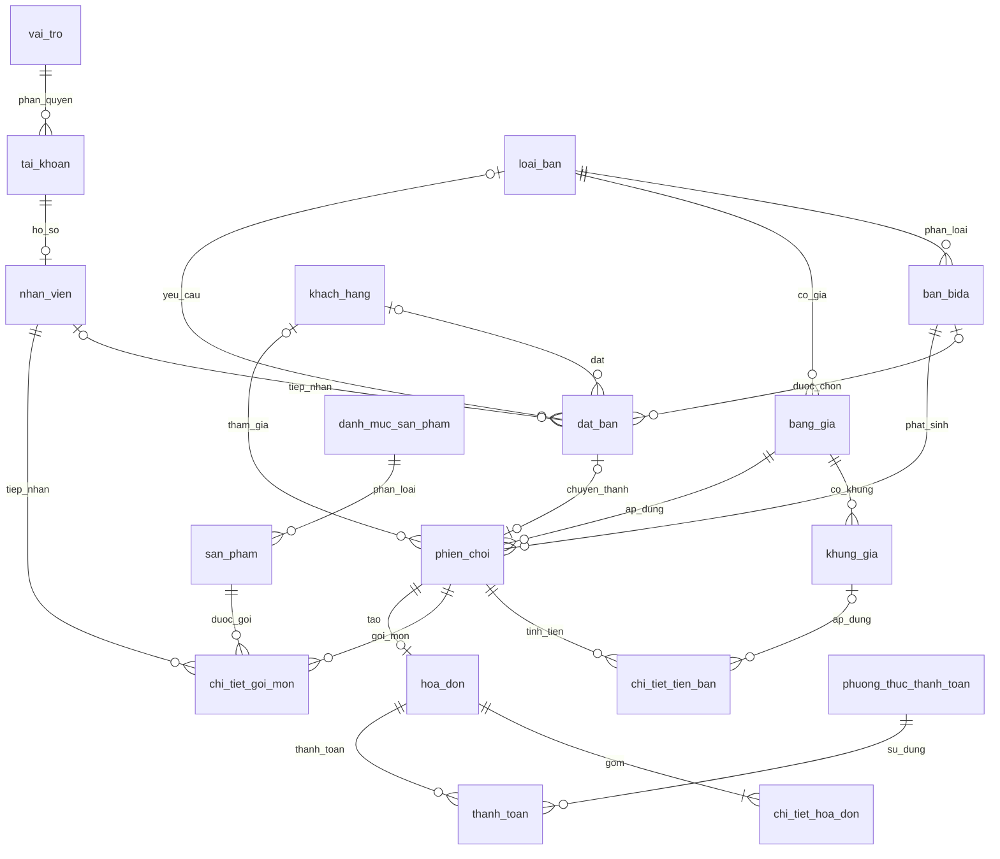

# CƠ SỞ DỮ LIỆU GIAI ĐOẠN 1 – QUẢN LÝ BIDA

## 1. Mục đích và phạm vi

Tài liệu rút gọn từ đặc tả dự án Billiards Management System, dùng để tạo Model đầu tiên bằng ASP.NET Core MVC + EF Core Code First + SQL Server.

Lựa chọn đã chốt:
- Quy mô: một cơ sở.
- Giá bàn: giá cố định và giá theo khung giờ.
- Khách hàng: quản lý hội viên.
- Kho: triển khai đầy đủ ở giai đoạn sau.
- Đặt bàn: có.
- Thanh toán: tiền mặt, chuyển khoản và kết hợp nhiều phương thức.

Giai đoạn đầu tập trung vào tài khoản, bàn, giá, phiên chơi, đặt bàn, hội viên cơ bản, sản phẩm, gọi món, hóa đơn và thanh toán. Các bảng kho đầy đủ, khuyến mãi, tích điểm, bảo trì, ca làm, chi phí và nhật ký được để dành cho Migration sau.

## 2. Quy ước đặt tên

- Tên bảng và cột bằng tiếng Việt không dấu, viết thường toàn bộ, dùng `_` phân tách từ: `khach_hang`, `ma_ban`, `thoi_gian_bat_dau`.
- Khóa chính: `<ten_bang>_id`; khóa ngoại dùng đúng tên khóa chính bảng được tham chiếu.
- `PK`: khóa chính; `FK`: khóa ngoại; `UQ`: duy nhất; `NULL`: được phép rỗng.
- Tiền: `decimal(18,2)`; thời điểm: `datetime2`; ngày: `date`; giờ: `time`.
- Mật khẩu chỉ lưu dạng hash.
- Trạng thái và loại nghiệp vụ dùng Enum C#, lưu dạng `int`.
- Class C# có thể dùng PascalCase theo chuẩn C#, nhưng tên bảng/cột trong SQL Server phải ánh xạ về chữ thường có dấu gạch dưới.

## 3. Danh sách bảng giai đoạn đầu

Có **18 bảng**:

| STT | Bảng | Mục đích |
|---:|---|---|
| 1 | `vai_tro` | Vai trò tài khoản |
| 2 | `tai_khoan` | Tài khoản đăng nhập |
| 3 | `nhan_vien` | Hồ sơ nhân viên |
| 4 | `loai_ban` | Loại bàn |
| 5 | `ban_bida` | Bàn bida |
| 6 | `bang_gia` | Giá cố định/theo khung |
| 7 | `khung_gia` | Khung giờ và đơn giá |
| 8 | `khach_hang` | Hội viên |
| 9 | `dat_ban` | Đặt bàn trước |
| 10 | `phien_choi` | Phiên chơi |
| 11 | `chi_tiet_tien_ban` | Các đoạn tính tiền bàn |
| 12 | `danh_muc_san_pham` | Danh mục sản phẩm |
| 13 | `san_pham` | Sản phẩm |
| 14 | `chi_tiet_goi_mon` | Món được gọi trong phiên |
| 15 | `hoa_don` | Hóa đơn |
| 16 | `chi_tiet_hoa_don` | Chi tiết khoản thu |
| 17 | `phuong_thuc_thanh_toan` | Tiền mặt/chuyển khoản |
| 18 | `thanh_toan` | Các lần thanh toán |

## 4. Chi tiết bảng và cột

### 4.1. `vai_tro`

| Cột | Kiểu | Ràng buộc / ý nghĩa |
|---|---|---|
| `vai_tro_id` | int | PK, tự tăng |
| `ten_vai_tro` | nvarchar(50) | UQ, bắt buộc |
| `mo_ta` | nvarchar(255) | NULL |

### 4.2. `tai_khoan`

| Cột | Kiểu | Ràng buộc / ý nghĩa |
|---|---|---|
| `tai_khoan_id` | int | PK, tự tăng |
| `ten_dang_nhap` | nvarchar(50) | UQ, bắt buộc |
| `mat_khau_hash` | nvarchar(255) | Bắt buộc |
| `email` | nvarchar(100) | NULL |
| `vai_tro_id` | int | FK → `vai_tro.vai_tro_id` |
| `trang_thai` | bit | Bắt buộc |
| `ngay_tao` | datetime2 | Bắt buộc |

### 4.3. `nhan_vien`

| Cột | Kiểu | Ràng buộc / ý nghĩa |
|---|---|---|
| `nhan_vien_id` | int | PK, tự tăng |
| `tai_khoan_id` | int | FK → `tai_khoan.tai_khoan_id`, UQ, NULL |
| `ho_ten` | nvarchar(100) | Bắt buộc |
| `so_dien_thoai` | nvarchar(15) | NULL |
| `dia_chi` | nvarchar(255) | NULL |
| `ngay_vao_lam` | date | NULL |
| `trang_thai` | bit | Bắt buộc |

Một tài khoản có tối đa một hồ sơ nhân viên; nhân viên có thể chưa được cấp tài khoản.

### 4.4. `loai_ban`

| Cột | Kiểu | Ràng buộc / ý nghĩa |
|---|---|---|
| `loai_ban_id` | int | PK, tự tăng |
| `ten_loai_ban` | nvarchar(100) | Bắt buộc |
| `mo_ta` | nvarchar(255) | NULL |
| `trang_thai` | bit | Bắt buộc |

### 4.5. `ban_bida`

| Cột | Kiểu | Ràng buộc / ý nghĩa |
|---|---|---|
| `ban_bida_id` | int | PK, tự tăng |
| `ma_ban` | nvarchar(20) | UQ, bắt buộc |
| `ten_ban` | nvarchar(50) | Bắt buộc |
| `loai_ban_id` | int | FK → `loai_ban.loai_ban_id` |
| `vi_tri` | nvarchar(100) | NULL |
| `trang_thai` | int | Enum: Trong, DangChoi, DaDat, BaoTri, ChoThanhToan |
| `mo_ta` | nvarchar(255) | NULL |

### 4.6. `bang_gia`

Hỗ trợ giá cố định và giá theo khung giờ.

| Cột | Kiểu | Ràng buộc / ý nghĩa |
|---|---|---|
| `bang_gia_id` | int | PK, tự tăng |
| `loai_ban_id` | int | FK → `loai_ban.loai_ban_id` |
| `ten_bang_gia` | nvarchar(100) | Bắt buộc |
| `kieu_tinh_gia` | int | Enum: CoDinh, TheoKhungGio |
| `gia_co_dinh` | decimal(18,2) | NULL nếu dùng khung giờ |
| `ngay_ap_dung` | datetime2 | Bắt buộc |
| `ngay_ket_thuc` | datetime2 | NULL |
| `trang_thai` | bit | Bắt buộc |

### 4.7. `khung_gia`

Dùng khi `bang_gia.kieu_tinh_gia = TheoKhungGio`.

| Cột | Kiểu | Ràng buộc / ý nghĩa |
|---|---|---|
| `khung_gia_id` | int | PK, tự tăng |
| `bang_gia_id` | int | FK → `bang_gia.bang_gia_id` |
| `ten_khung` | nvarchar(100) | Bắt buộc |
| `gio_bat_dau` | time | Bắt buộc |
| `gio_ket_thuc` | time | Bắt buộc |
| `thu_trong_tuan` | int | NULL; quy ước 1–7, NULL là mọi ngày |
| `gia_theo_gio` | decimal(18,2) | Bắt buộc |

### 4.8. `khach_hang`

| Cột | Kiểu | Ràng buộc / ý nghĩa |
|---|---|---|
| `khach_hang_id` | int | PK, tự tăng |
| `ma_khach_hang` | nvarchar(20) | UQ, bắt buộc |
| `ho_ten` | nvarchar(100) | Bắt buộc |
| `so_dien_thoai` | nvarchar(15) | Có thể UQ nếu mỗi hội viên dùng số riêng |
| `email` | nvarchar(100) | NULL |
| `ngay_dang_ky` | datetime2 | Bắt buộc |
| `trang_thai` | bit | Bắt buộc |

Giai đoạn đầu chỉ lưu hồ sơ hội viên cơ bản; hạng thành viên và tích điểm thêm sau.

### 4.9. `dat_ban`

| Cột | Kiểu | Ràng buộc / ý nghĩa |
|---|---|---|
| `dat_ban_id` | int | PK, tự tăng |
| `khach_hang_id` | int | FK → `khach_hang.khach_hang_id`, NULL |
| `ban_bida_id` | int | FK → `ban_bida.ban_bida_id`, NULL |
| `loai_ban_id` | int | FK → `loai_ban.loai_ban_id`, NULL |
| `nhan_vien_id` | int | FK → `nhan_vien.nhan_vien_id`, NULL |
| `ten_khach` | nvarchar(100) | Bắt buộc |
| `so_dien_thoai` | nvarchar(15) | Bắt buộc |
| `thoi_gian_bat_dau` | datetime2 | Bắt buộc |
| `thoi_gian_ket_thuc` | datetime2 | Bắt buộc |
| `trang_thai` | int | Enum: ChoXacNhan, DaXacNhan, DaNhanBan, DaHuy, KhongDen |
| `ghi_chu` | nvarchar(255) | NULL |

Đặt bàn cụ thể: có `ban_bida_id`, `loai_ban_id` NULL. Đặt theo loại: có `loai_ban_id`, `ban_bida_id` NULL. Không cho phép cả hai cùng có hoặc cùng không có giá trị. Phải kiểm tra trùng khoảng thời gian.

### 4.10. `phien_choi`

| Cột | Kiểu | Ràng buộc / ý nghĩa |
|---|---|---|
| `phien_choi_id` | int | PK, tự tăng |
| `ban_bida_id` | int | FK → `ban_bida.ban_bida_id` |
| `khach_hang_id` | int | FK → `khach_hang.khach_hang_id`, NULL |
| `dat_ban_id` | int | FK → `dat_ban.dat_ban_id`, UQ, NULL |
| `bang_gia_id` | int | FK → `bang_gia.bang_gia_id` |
| `nhan_vien_mo_ban_id` | int | FK → `nhan_vien.nhan_vien_id` |
| `nhan_vien_dong_ban_id` | int | FK → `nhan_vien.nhan_vien_id`, NULL |
| `kieu_tinh_gia_ap_dung` | int | Snapshot kiểu tính giá |
| `gia_co_dinh_ap_dung` | decimal(18,2) | Snapshot, NULL nếu tính theo khung |
| `thoi_gian_bat_dau` | datetime2 | Bắt buộc |
| `thoi_gian_ket_thuc` | datetime2 | NULL khi chưa kết thúc |
| `thoi_gian_tam_dung` | int | Tổng phút tạm dừng, mặc định 0 |
| `tong_tien_gio` | decimal(18,2) | Mặc định 0 |
| `trang_thai` | int | Enum: DangChoi, TamDung, DaKetThuc, DaThanhToan, DaHuy |
| `ghi_chu` | nvarchar(255) | NULL |

`khach_hang_id` được NULL để vẫn phục vụ khách chưa đăng ký. Lưu snapshot giá để bảng giá thay đổi không ảnh hưởng phiên cũ.

### 4.11. `chi_tiet_tien_ban`

Lưu từng đoạn tính tiền, cần thiết khi phiên chơi đi qua nhiều khung giờ có giá khác nhau.

| Cột | Kiểu | Ràng buộc / ý nghĩa |
|---|---|---|
| `chi_tiet_tien_ban_id` | int | PK, tự tăng |
| `phien_choi_id` | int | FK → `phien_choi.phien_choi_id` |
| `ban_bida_id` | int | FK → `ban_bida.ban_bida_id` |
| `khung_gia_id` | int | FK → `khung_gia.khung_gia_id`, NULL nếu giá cố định |
| `thoi_gian_bat_dau` | datetime2 | Bắt buộc |
| `thoi_gian_ket_thuc` | datetime2 | Bắt buộc |
| `so_phut` | int | Bắt buộc |
| `don_gia_theo_gio` | decimal(18,2) | Snapshot đơn giá |
| `thanh_tien` | decimal(18,2) | Bắt buộc |

### 4.12. `danh_muc_san_pham`

| Cột | Kiểu | Ràng buộc / ý nghĩa |
|---|---|---|
| `danh_muc_id` | int | PK, tự tăng |
| `ten_danh_muc` | nvarchar(100) | Bắt buộc |
| `mo_ta` | nvarchar(255) | NULL |
| `trang_thai` | bit | Bắt buộc |

### 4.13. `san_pham`

| Cột | Kiểu | Ràng buộc / ý nghĩa |
|---|---|---|
| `san_pham_id` | int | PK, tự tăng |
| `ma_san_pham` | nvarchar(30) | UQ, bắt buộc |
| `ten_san_pham` | nvarchar(150) | Bắt buộc |
| `danh_muc_id` | int | FK → `danh_muc_san_pham.danh_muc_id` |
| `don_vi_tinh` | nvarchar(30) | Bắt buộc |
| `gia_nhap` | decimal(18,2) | Mặc định 0 |
| `gia_ban` | decimal(18,2) | Bắt buộc |
| `so_luong_ton` | decimal(18,2) | Mặc định 0 |
| `hinh_anh` | nvarchar(255) | NULL |
| `trang_thai` | bit | Bắt buộc |

### 4.14. `chi_tiet_goi_mon`

| Cột | Kiểu | Ràng buộc / ý nghĩa |
|---|---|---|
| `chi_tiet_goi_mon_id` | int | PK, tự tăng |
| `phien_choi_id` | int | FK → `phien_choi.phien_choi_id` |
| `san_pham_id` | int | FK → `san_pham.san_pham_id` |
| `nhan_vien_id` | int | FK → `nhan_vien.nhan_vien_id` |
| `so_luong` | decimal(18,2) | Lớn hơn 0 |
| `don_gia` | decimal(18,2) | Snapshot giá lúc gọi |
| `thanh_tien` | decimal(18,2) | Bắt buộc |
| `thoi_gian_goi` | datetime2 | Bắt buộc |
| `trang_thai` | int | Enum: Moi, DangChuanBi, DaPhucVu, DaHuy |
| `ghi_chu` | nvarchar(255) | NULL |

### 4.15. `hoa_don`

| Cột | Kiểu | Ràng buộc / ý nghĩa |
|---|---|---|
| `hoa_don_id` | int | PK, tự tăng |
| `ma_hoa_don` | nvarchar(30) | UQ, bắt buộc |
| `phien_choi_id` | int | FK → `phien_choi.phien_choi_id`, UQ |
| `khach_hang_id` | int | FK → `khach_hang.khach_hang_id`, NULL |
| `nhan_vien_id` | int | FK → `nhan_vien.nhan_vien_id` |
| `thoi_gian_lap` | datetime2 | Bắt buộc |
| `tien_gio` | decimal(18,2) | Bắt buộc |
| `tien_san_pham` | decimal(18,2) | Bắt buộc |
| `tien_giam_gia` | decimal(18,2) | Mặc định 0 |
| `tong_tien` | decimal(18,2) | Bắt buộc |
| `da_thanh_toan` | decimal(18,2) | Mặc định 0 |
| `trang_thai` | int | Enum: ChuaThanhToan, DaThanhToan, DaHuy |

### 4.16. `chi_tiet_hoa_don`

| Cột | Kiểu | Ràng buộc / ý nghĩa |
|---|---|---|
| `chi_tiet_hoa_don_id` | int | PK, tự tăng |
| `hoa_don_id` | int | FK → `hoa_don.hoa_don_id` |
| `ten_hang_hoa` | nvarchar(150) | Snapshot tên khoản thu |
| `loai_chi_phi` | int | Enum: TienBan, SanPham |
| `so_luong` | decimal(18,2) | Bắt buộc |
| `don_gia` | decimal(18,2) | Snapshot đơn giá |
| `thanh_tien` | decimal(18,2) | Bắt buộc |

### 4.17. `phuong_thuc_thanh_toan`

| Cột | Kiểu | Ràng buộc / ý nghĩa |
|---|---|---|
| `phuong_thuc_id` | int | PK, tự tăng |
| `ten_phuong_thuc` | nvarchar(50) | UQ; TienMat, ChuyenKhoan |
| `mo_ta` | nvarchar(255) | NULL |
| `trang_thai` | bit | Bắt buộc |

### 4.18. `thanh_toan`

| Cột | Kiểu | Ràng buộc / ý nghĩa |
|---|---|---|
| `thanh_toan_id` | int | PK, tự tăng |
| `hoa_don_id` | int | FK → `hoa_don.hoa_don_id` |
| `phuong_thuc_id` | int | FK → `phuong_thuc_thanh_toan.phuong_thuc_id` |
| `so_tien` | decimal(18,2) | Bắt buộc |
| `ma_giao_dich` | nvarchar(100) | NULL; dùng cho chuyển khoản |
| `thoi_gian_thanh_toan` | datetime2 | Bắt buộc |
| `trang_thai` | int | Enum: ChoXuLy, ThanhCong, ThatBai, HoanTien |

Một hóa đơn có thể có nhiều dòng thanh toán. Ví dụ hóa đơn 200.000 đồng: 100.000 đồng tiền mặt và 100.000 đồng chuyển khoản.

## 5. Quan hệ giữa các bảng

| Bảng cha | Bảng con | Quan hệ |
|---|---|---|
| `vai_tro` | `tai_khoan` | 1-N |
| `tai_khoan` | `nhan_vien` | 1-0..1 |
| `loai_ban` | `ban_bida` | 1-N |
| `loai_ban` | `bang_gia` | 1-N |
| `bang_gia` | `khung_gia` | 1-N |
| `khach_hang` | `dat_ban` | 1-N |
| `ban_bida` | `dat_ban` | 1-N |
| `loai_ban` | `dat_ban` | 1-N |
| `nhan_vien` | `dat_ban` | 1-N |
| `ban_bida` | `phien_choi` | 1-N theo lịch sử |
| `khach_hang` | `phien_choi` | 1-N |
| `dat_ban` | `phien_choi` | 1-0..1 |
| `bang_gia` | `phien_choi` | 1-N |
| `phien_choi` | `chi_tiet_tien_ban` | 1-N |
| `danh_muc_san_pham` | `san_pham` | 1-N |
| `phien_choi` | `chi_tiet_goi_mon` | 1-N |
| `san_pham` | `chi_tiet_goi_mon` | 1-N |
| `nhan_vien` | `chi_tiet_goi_mon` | 1-N |
| `phien_choi` | `hoa_don` | 1-0..1 |
| `hoa_don` | `chi_tiet_hoa_don` | 1-N |
| `hoa_don` | `thanh_toan` | 1-N |
| `phuong_thuc_thanh_toan` | `thanh_toan` | 1-N |

## 6. ERD rút gọn



## 7. Enum cần tạo

```csharp
public enum TrangThaiBan
{
    Trong = 0,
    DangChoi = 1,
    DaDat = 2,
    BaoTri = 3,
    ChoThanhToan = 4
}

public enum KieuTinhGia
{
    CoDinh = 0,
    TheoKhungGio = 1
}

public enum TrangThaiDatBan
{
    ChoXacNhan = 0,
    DaXacNhan = 1,
    DaNhanBan = 2,
    DaHuy = 3,
    KhongDen = 4
}

public enum TrangThaiPhien
{
    DangChoi = 0,
    TamDung = 1,
    DaKetThuc = 2,
    DaThanhToan = 3,
    DaHuy = 4
}

public enum TrangThaiGoiMon
{
    Moi = 0,
    DangChuanBi = 1,
    DaPhucVu = 2,
    DaHuy = 3
}

public enum LoaiChiPhi
{
    TienBan = 0,
    SanPham = 1
}

public enum TrangThaiHoaDon
{
    ChuaThanhToan = 0,
    DaThanhToan = 1,
    DaHuy = 2
}

public enum TrangThaiThanhToan
{
    ChoXuLy = 0,
    ThanhCong = 1,
    ThatBai = 2,
    HoanTien = 3
}
```

## 8. Các bảng để dành cho giai đoạn sau

| Nhóm | Bảng | Chức năng |
|---|---|---|
| Hội viên nâng cao | `hang_thanh_vien`, `lich_su_diem` | Phân hạng và tích/sử dụng điểm |
| Khuyến mãi | `khuyen_mai`, `hoa_don_khuyen_mai` | Mã giảm giá |
| Kho đầy đủ | `nha_cung_cap`, `phieu_nhap`, `chi_tiet_phieu_nhap`, `phieu_kiem_ke`, `chi_tiet_phieu_kiem_ke`, `giao_dich_kho` | Nhập, xuất, kiểm kê, lịch sử kho |
| Bảo trì | `bao_tri_ban` | Lịch sử sửa chữa bàn |
| Nhật ký | `lich_su_hoat_dong` | Nhật ký thao tác |
| Cấu hình | `tham_so_he_thong` | Tham số hệ thống |
| Nhân sự | `ca_lam`, `phan_cong_ca`, `chi_phi` | Ca làm và chi phí |

Giai đoạn đầu giữ `so_luong_ton` trong `san_pham` để hiển thị tồn cơ bản. Khi triển khai kho đầy đủ, mọi thay đổi tồn phải được ghi vào chứng từ và `giao_dich_kho`, đồng thời cập nhật số dư trong cùng transaction.

## 9. Quy tắc nghiệp vụ cần giữ ngay

1. Một bàn chỉ có tối đa một phiên chơi đang hoạt động.
2. Không cho phép hai lượt đặt cùng một bàn có khoảng thời gian chồng lấn.
3. Khi mở phiên phải lưu bảng giá và đơn giá áp dụng tại thời điểm đó.
4. Phiên đi qua nhiều khung giờ phải chia thành các đoạn trong `chi_tiet_tien_ban`.
5. Giá sản phẩm được snapshot tại thời điểm gọi món.
6. Một phiên chơi chỉ có một hóa đơn chính thức.
7. Một hóa đơn có thể có nhiều lần thanh toán và nhiều phương thức.
8. Chỉ giao dịch thành công mới được cộng vào số tiền đã thanh toán.
9. Không xóa vật lý hóa đơn và giao dịch đã phát sinh.
10. Thao tác thanh toán phải dùng database transaction.

## 10. Thứ tự tạo Model và Migration

Tạo Model theo thứ tự phụ thuộc:

1. `VaiTro`, `TaiKhoan`, `NhanVien`.
2. `LoaiBan`, `BanBida`, `BangGia`, `KhungGia`.
3. `KhachHang`, `DatBan`.
4. `PhienChoi`, `ChiTietTienBan`.
5. `DanhMucSanPham`, `SanPham`, `ChiTietGoiMon`.
6. `HoaDon`, `ChiTietHoaDon`.
7. `PhuongThucThanhToan`, `ThanhToan`.

Sau khi tạo Model, cấu hình `DbContext` và Fluent API cho khóa ngoại, unique index, precision và quan hệ một-một. Sau đó mới tạo Migration đầu tiên.

```bash
dotnet ef migrations add InitialCreate
dotnet ef database update
```

Không tạo các bảng giai đoạn sau trong Migration đầu tiên. Khi cần mở rộng, thêm Model và tạo Migration mới.
